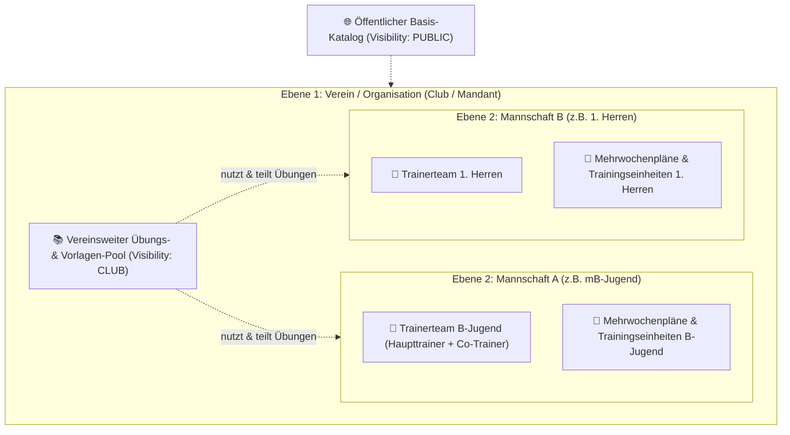
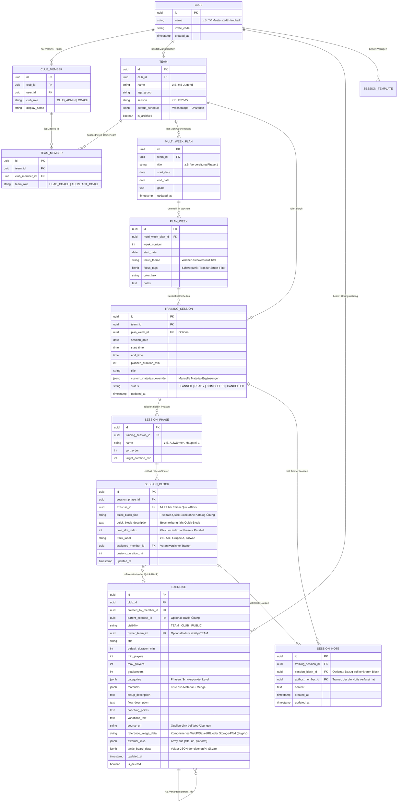
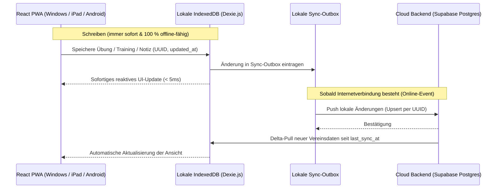

# MVP-Spezifikation: Handball Trainings- & Planungs-App

**Version:** 1.2 (MVP – Web-First Offline-PWA, Vereins-Mandantenmodell & KI-Übungs-Backend)  
**Datum:** 16. November 2026  
**Zielplattformen:** Windows (Browser & installierbare Desktop-PWA), Android & iOS / iPadOS (Installierbare Vollbild-PWA komplett ohne App-Store-Zwang)  
**Technologie-Stack:** TypeScript, React (Vite), Tailwind CSS, Dexie.js (IndexedDB Offline-First), SVG-Taktikboard, Supabase (PostgreSQL + Auth + Storage)  

---

## 1. Projektübersicht & Vision

### 1.1 Zielsetzung
Die App unterstützt Handball-Trainerteams und ganze Handballvereine bei der ganzheitlichen Planung, Dokumentation und Durchführung des Trainingsbetriebs. Sie verbindet die schnelle **Erstellung, Web-Referenzierung und KI-gestützte Erfassung** von Übungen, Trainingseinheiten und mehrwöchigen Trainingsplänen (Mesozyklen) am **Windows-PC** mit der praxisnahen, **100 % offline-fähigen Durchführung, Live-Präsentation und spontanen Anpassung** direkt in der Sporthalle auf **Android- und Apple-Tablets/-Smartphones** – komplett **ohne Abhängigkeit von Apple App Store oder Google Play Store**.

### 1.2 Plattform-Paradigma & Store-freie Bereitstellung (Offline-PWA)

Die Anwendung wird als **Offline-First Progressive Web App (PWA)** entwickelt. Dadurch läuft sie über eine einzige Web-URL auf allen Zielsystemen, lässt sich wie eine native App auf dem Gerät installieren und speichert alle Daten lokal auf dem Endgerät:

| Plattform | Installation & Bereitstellung (ohne Store) | Primärer Nutzungskontext & UX-Schwerpunkt |
| :--- | :--- | :--- |
| **Windows (Desktop-PC)** | Direkt im Browser (Edge/Chrome) nutzbar oder mit 1 Klick über die Adressleiste als **eigenständige Windows-App** (eigenes Fenster, Taskleisten- & Startmenü-Icon) installierbar. | **Vorbereitungs- & Übungs-Backend:** Mehrspaltiges Widescreen-Cockpit, `Strg+V` Einfügen von Web-Screenshots, KI-JSON-Massenimport, schnelles Zeichnen im SVG-Taktikboard, Drag-and-Drop im Trainings- und Mehrwochenplan. |
| **iPad & iPhone (iOS / iPadOS)** | Öffnen in Safari $\rightarrow$ *„Teilen $\rightarrow$ Zum Home-Bildschirm hinzufügen"* (integrierter Onboarding-Hinweis in der App). Keine 99 €/Jahr Apple-Gebühr, kein Store-Review nötig. | **Einsatz in der Sporthalle:** Startet im echten Vollbild (ohne Browserleiste), 100 % offline-fähig in der Halle, große Touch-Ziele (`>= 48px`), Split-Screen (Ablaufplan + Taktikboard), Vollbild-Taktiktafel mit Live-Zeichenstift, Timer & Einzel-Notizen. |
| **Android (Tablet & Smartphone)** | Öffnen in Chrome $\rightarrow$ *„App installieren / Zum Startbildschirm hinzufügen"*. (Zusätzlich optional per TWA als `.apk` verpackbar). | **Einsatz in der Sporthalle & am Geräteraum:** Vollbild-App auf dem Homescreen, 100 % offline-fähig, kompakte Material-Packliste, Step-by-Step-Trainingsdurchführung mit Timer & Quick-Swap. |

---

## 2. Mandantenmodell (Verein $\rightarrow$ Mannschaft $\rightarrow$ Trainerteam) & Skalierungsstrategie

Damit die App zunächst im eigenen Trainerteam genutzt, anschließend auf alle Trainer des eigenen Vereins ausgerollt und langfristig für beliebig viele Vereine publiziert werden kann, basiert die Architektur von Beginn an auf einem **3-stufigen Multi-Tenant-Modell**:



### 2.1 Die 3 Ebenen im Detail

1. **Ebene 1 – Verein (`CLUB` / Mandant):**
   * Bildet die oberste organisatorische Klammer (z.B. *„TV Musterstadt Handball"*). Daten verschiedener Vereine sind in der Datenbank strikt voneinander isoliert (Row-Level-Security anhand `club_id`).
   * Ein Trainer-Account kann bei Bedarf auch Mitglied in mehreren Vereinen sein (z.B. Heimatverein + Bezirks-/Kreisauswahl) und in der App zwischen diesen wechseln.
2. **Ebene 2 – Mannschaft (`TEAM`):**
   * Innerhalb eines Vereins werden beliebig viele Mannschaften angelegt (z.B. *mD-Jugend*, *wB-Jugend*, *1. Damen*, *1. Herren*).
   * Mehrwöchige Trainingspläne, feste Trainingszeiten und einzelne Trainingseinheiten gehören immer zu genau einer Mannschaft.
3. **Ebene 3 – Zuordnung & Sichtbarkeit (`TEAM_MEMBER` & `Visibility`):**
   * **Übersichtlichkeit im Kalender:** Trainer werden innerhalb des Vereins ihren konkreten Mannschaften zugeordnet (`TEAM_MEMBER`). So sieht ein B-Jugend-Trainer standardmäßig nur die Pläne seiner Mannschaft(en) und wird nicht von den Terminen anderer Teams überflutet.
   * **3 Sichtbarkeitsstufen für Übungen & Vorlagen (`visibility`):**
     * `TEAM` (Intern im Trainerteam): Nur für die Trainer der zugeordneten Mannschaft sichtbar (z.B. eigene Entwürfe oder spezielle Spielzüge der 1. Herren).
     * `CLUB` (Vereinsweit): Für **alle** Trainer des Vereins im gemeinsamen Vereins-Übungskatalog sichtbar und nutzbar.
     * `PUBLIC` (Plattformweit): Übergreifender Standard-Übungskatalog für alle Vereine (durch System-Admins gepflegt).

### 2.2 Rollen & Berechtigungen im Verein

| Rolle | Berechtigungen |
| :--- | :--- |
| **Vereins-Admin / Jugendkoordinator (`CLUB_ADMIN`)** | Verwaltet den Verein, legt Mannschaften an, erzeugt Einladungs-Codes/Links für Trainer, hat Einblick in alle Mannschaften des Vereins und kann Übungen als offizielle Vereins-Übungen (`CLUB`) freigeben oder kategorisieren. |
| **Mannschafts-Trainer (`TEAM_COACH`)** | Voller Lese- und Schreibzugriff auf die Mehrwochenpläne, Trainingseinheiten und Vorlagen der ihm zugewiesenen Mannschaft(en). Kann eigene Übungen erstellen und im Verein (`CLUB`) oder Team (`TEAM`) teilen. |

---

## 3. Funktionale Anforderungen (Epics & Detailspezifikation)

### Epic 1: Authentifizierung, Vereins- & Mannschaftsverwaltung
* **Registrierung & Login:** E-Mail/Passwort-Authentifizierung (oder Magic Link).
* **Vereins-Beitritt & Gründung:**
  * Neues Konto kann entweder einen **neuen Verein anlegen** (wird automatisch `CLUB_ADMIN`) oder per **Einladungs-Link / Code** einem bestehenden Verein und einer Mannschaft beitreten.
* **PWA-Installations-Assistent:**
  * Erkennt automatisch, wenn ein Trainer die App auf iOS/Android noch im normalen Browser-Tab geöffnet hat, und zeigt eine bebilderte 10-Sekunden-Anleitung (*„Zum Home-Bildschirm hinzufügen für Vollbild & garantierte Offline-Verfügbarkeit in der Halle"*).
* **Mannschaftsverwaltung:**
  * Anlegen, Bearbeiten und Archivieren von Mannschaften (Name, Altersklasse, Saison).
  * Konfiguration der wiederkehrenden **Standard-Trainingszeiten** pro Mannschaft (z.B. *Dienstag 18:30–20:00 Uhr*, *Donnerstag 19:00–20:30 Uhr*) als Fundament für die automatische Kalender-Generierung.

---

### Epic 2: Desktop Übungs-Backend, Web-Referenzen & KI-JSON-Importer

Das Übungs-Backend am Windows-PC ist darauf optimiert, sowohl eigene Übungen schnell zu entwerfen als auch bestehende Übungen aus dem Web, aus PDFs oder Lehrgangsskripten mit minimalem Aufwand in die App zu übernehmen.

#### 2.1 Datenfelder einer Übung
* **Titel:** Prägnanter Name der Übung (Pflichtfeld).
* **Sichtbarkeit (`visibility`):** `TEAM` (nur meine Mannschaft) oder `CLUB` (für den gesamten Verein freigegeben).
* **Empfohlene Dauer:** Standarddauer in Minuten (z.B. `15 Min`), im Training individuell überschreibbar.
* **Kategorien & Schwerpunkt-Tags (Mehrfachauswahl):**
  * *Trainingsphase:* Aufwärmen, Kleines Spiel, Torwart-Einwerfen, Grundübung, Grundspiel, Zielspiel, Athletik/Koordination, Cool-Down.
  * *Handball-Schwerpunkt:* Angriff (Individual / Kleingruppe / Mannschaft), Abwehr (Individual / Kleingruppe / Mannschaft / `6:0` / `5:1` / `3:2:1`), Tempospiel (1. Welle / 2. Welle / Rückzug), Wurftraining, Passen & Fangen, Torwart-Technik.
  * *Komplexität:* Basis, Fortgeschritten, Leistung.
* **Spieleranzahl & Torhüter:** Min./Max. Feldspieler (z.B. `6–12 Spieler`) und benötigte Torhüter (z.B. `1–2 TW`).
* **Benötigtes Material:** Strukturierte Auswahlliste mit Mengenangabe (Bälle, Hütchen, Leibchen/Parteibänder, Koordinationsleiter, Weichbodenmatte, Stangen/Air-Body, Kasten, Wurfecken/Zielrahmen).
* **Strukturierte Textbeschreibung:**
  * *Aufbau & Organisation:* Positionierung, Gruppengrößen, Materialaufbau.
  * *Ablauf:* Schrittweise Beschreibung des Übungsablaufs.
  * *Coaching-Punkte / Korrekturen:* Worauf muss der Trainer achten (z.B. „Stoßbewegung auf die Nahtstelle", „Wurfarm hoch")?
  * *Variationen / Steigerungen:* Hinweise zur Anpassung von Schwierigkeit oder Spielerzahl.

#### 2.2 Web-Referenzen & Direktes Einfügen von bestehenden Zeichnungen (`Strg+V`)
Trainer können bestehende Übungen und Skizzen aus dem Web oder aus PDF-Dokumenten ohne Nachzeichnen übernehmen:
* **Zwischenablage-Import (`Strg+V` / Drag-and-Drop für Referenz-Bilder):**
  * Macht der Trainer am Windows-PC mit dem Snipping-Tool (`Win + Shift + S`) einen Screenshot einer Übungszeichnung aus einem PDF oder einer Webseite und drückt im Übungs-Editor `Strg+V`, wird das Bild automatisch komprimiert (WebP), lokal für den Offline-Einsatz gecacht und als **Referenz-Skizze (`reference_image`)** an der Übung gespeichert.
* **Dualer Darstellungs-Modus (Taktikboard vs. Referenz-Bild):**
  * Eine Übung kann entweder eine **interaktive Taktikboard-Skizze**, ein **eingefügtes Referenz-Bild aus dem Web** oder **beides** (umschaltbar per Tab *„Taktikboard"* | *„Original-Skizze"*) besitzen.
* **Quellen-URL & Externe Video-/Web-Links (`source_url` & `external_links`):**
  * Speicherung der Original-Fundstelle im Web (z.B. Link zum DHB-Artikel, YouTube-Video, Instagram-Reel oder Lehrgangs-PDF), direkt anklickbar als Referenz.

#### 2.3 KI-JSON-Importer & Prompt-Generator (Übungen inkl. Zeichnungen per KI umwandeln)
Um bestehende Übungen (inkl. Skizzen/Zeichnungen aus PDFs oder Screenshots) kostenlos und in hoher Qualität mit externen KI-Systemen (ChatGPT, Gemini, Claude) in echte, editierbare App-Übungen umzuwandeln, enthält das Desktop-Backend ein dediziertes **KI-Import-Modul**:
1. **1-Klick „KI-System-Prompt kopieren":**
   * Die App stellt einen fertig formulierten, kopierbaren Prompt bereit, der einer externen KI genau erklärt, wie sie aus einem hochgeladenen Bild/Screenshot oder PDF-Text einer Handball-Übung ein valides JSON-Objekt (Einzelübung oder Array mehrerer Übungen) inklusive **übersetzter Taktikboard-Koordinaten (`tactic_board_data`)** erzeugt.
2. **KI-JSON-Import-Dialog (Einzel- & Batch-Import mit Live-Vorschau):**
   * Der Trainer fügt die von der KI erzeugte JSON-Antwort per `Strg+V` in das Import-Fenster der App ein.
   * Die App validiert das JSON sofort, zeigt eine **Vorschau aller erkannten Übungen inkl. gerenderter Taktikboard-Skizze** an und lässt den Trainer die Übungen mit einem Klick in die Datenbank übernehmen (und bei Bedarf direkt im Taktikboard feinjustieren).

#### 2.4 Duplizieren & Variieren (Varianten-Management)
* **Funktion „Als Variante duplizieren":**
  * Kopiert alle Beschreibungen, Materialien, Tags sowie die Vektor-Skizze / das Referenzbild in eine neue Übung und setzt `parent_exercise_id` auf die Ursprungs-Übung.
  * In der Detailansicht einer Übung (und beim Tauschen einer Übung in der Sporthalle) werden alle verknüpften Varianten direkt als Schnellwahl angezeigt.

---

### Epic 3: Integriertes Handball-Taktikboard (Interaktives SVG-Zeichenwerkzeug)

Das Taktikboard basiert auf einem reaktiven **SVG-Vektor-Canvas** und ist speziell auf **Handball-Trainingsübungen** sowie eine schnelle Bedienung per Maus (Windows) und Finger/Stift (Tablet) ausgelegt.

#### 3.1 Spielfeld-Hintergründe (Templates)
1. **Halbfeld (Vertikal / Horizontal):** Fokus auf 6m-Torraum, 4m-Torwartgrenzlinie, 7m-Strich, 9m-Freiwurflinie und Auswechselraum.
2. **Ganzfeld:** Für Tempospiel, Gegenstoß, Rückzugsverhalten und Aufwärmspiele.
3. **Torraum- & 9m-Sektor (Zoom):** Großer Ausschnitt für Wurfserien, Kooperation Kreis/Rückraum und Torwarttraining.
4. **Neutrales Feld / Freifläche:** Für Koordinations-, Athletik- oder freie Passübungen.

#### 3.2 Handball-spezifische Schnellfunktionen (Speed-Drawing UX)
* **Formations-Presets (1-Klick-Startaufstellungen):**
  * Mit einem Klick wird eine komplette Grundaufstellung sauber positioniert auf das Spielfeld gesetzt, die danach frei angepasst werden kann:
    * *Angriff:* `Angriff 3:3 (LA, RL, RM, RR, RA, KM)`, `Angriff 4:2 (2 Kreisläufer)`, `Rückraum-Dreieck (RL, RM, RR)`.
    * *Abwehr:* `6:0-Abwehr`, `5:1-Abwehr (mit VM)`, `3:2:1-Abwehr`, `4:2-Abwehr`.
* **Anstellreihen / Gruppen-Darstellung (`isQueue`):**
  * Da im Training auf einer Position oft eine Warteschlange steht (z.B. 4 Spieler auf `RL` mit Ball), kann jedes Spieler-Symbol per Schalter als **„Anstellreihe / Gruppe"** dargestellt werden (visuell durch gestapelte Mehrfach-Ringe `((RL))` und optionales Mengen-Badge wie `x4` + Ballwagen-Symbol).
* **Stempel-Modus für Material & Spieler:**
  * Solange ein Werkzeug (z.B. *Hütchen*) aktiv ist, platziert jeder Klick/Tap auf das Spielfeld sofort ein weiteres Element, ohne das Symbol jedes Mal neu aus der Werkzeugleiste ziehen zu müssen.
* **Magnetisches Snapping & Mitziehen:**
  * Startet man einen Pfeil auf einem Spieler, rastet der Pfeilanfang magnetisch am Spieler (`fromNodeId`) ein. Wird der Spieler nachträglich verschoben, passt sich der Startpunkt des Pfeils automatisch an.
* **Verkettete Aktionspunkte (Wegpunkte / Multi-Step-Ketten):**
  * Am **Endpunkt eines Laufwegs** erscheint ein kleiner Ankerpunkt (`WAYPOINT`). Von diesem Punkt aus kann direkt die Folgeaktion gezogen werden (z.B. `RL` läuft in die Lücke `[1]` $\rightarrow$ spielt von dort den Pass zu `RM` `[2]` $\rightarrow$ und läuft weiter zur Sperre am Kreis `[3]`).

#### 3.3 Platzierbare Objekte & Pfeiltypen
* **Spieler-Symbole:**
  * Angreifer (Kreis mit Position `LA, RL, RM, RR, RA, KM` oder Nummer `1–9`, optional als Anstellreihe `(( ))`).
  * Abwehrspieler (Dreieck/Block-Symbol mit `AL, HL, IR, IL, HR, AR, VM`).
  * Torwart (`TW`), Trainer / fester Anspieler (`T`).
  * Ballbesitz-Indikator (an Spieler geheftet oder frei).
* **Material-Symbole:**
  * Hütchen (mehrfarbig), Ball / Ballwagen, Stange / Air-Body-Dummy, Kasten / Langbank, Weichbodenmatte, Koordinationsleiter, Mini-Tor / Wurfecken-Zielrahmen.
* **Handball-Pfeiltypen (mit optionaler Schritt-Nummerierung `1`, `2`, `3`):**
  * **Laufweg ohne Ball:** Durchgezogene Linie mit Pfeil (`────►`).
  * **Passweg:** Gestrichelte Linie mit Pfeil (`- - - ►`).
  * **Prellen / Dribbling:** Wellen-/Zickzack-Linie mit Pfeil (`~~~~~►`).
  * **Torwurf:** Doppellinie / betonte Linie mit Pfeil (`════►`).
  * **Sperre / Block stellen:** Linie mit T-Balken (`────┤`).
  * **Finte / Körpertäuschung:** Kurzer Richtungswechsel-Zacken im Laufweg.
  * **Zonen-Markierung:** Halbtransparentes Rechteck/Ellipse für Ziel- oder Verbotszonen.

---

### Epic 4: Trainingsplanung (Speed-Planning für einzelne Trainingseinheiten)

#### 4.1 Kopfdaten & Automatische Material-Aggregation
* **Mannschaft, Datum, Start-/Endzeit** (z.B. `Di, 17.11.2026, 18:30–20:00 Uhr` $\rightarrow$ `90 Min` Zeitbudget) sowie **Tagesschwerpunkt**.
* **Automatische Material-Liste:** Aggregiert automatisch die benötigten Materialien aller eingeplanten Übungen (Maximalbedarf pro Materialtyp, z.B. `12 Hütchen, 1 Koordinationsleiter, 2 Satz Leibchen`) und erlaubt manuelle Ergänzungen.

#### 4.2 Phasen-Struktur & Zeitbudget-Kontrolle
* Gliederung in chronologische Phasen (z.B. *Aufwärmen*, *Torwart-Einwerfen*, *Hauptteil 1*, *Hauptteil 2*, *Abschlussspiel*).
* **Live-Zeitkontrolle:** Summiert die Dauer aller Blöcke und warnt visuell bei Über- oder Unterschreitung der verfügbaren Hallenzeit.

#### 4.3 Parallele Übungsblöcke (Gruppenteilung / Haupt- & Co-Trainer)
* Innerhalb einer Phase können **parallele Spuren (Tracks)** im selben Zeitfenster angelegt werden (z.B. *Spur 1: Torhüter + Außen mit Co-Trainer (20 Min)* parallel zu *Spur 2: Rückraum + Kreis mit Haupttrainer (20 Min)*).
* Für die Gesamtzeitberechnung des Trainings zählt bei parallelen Spuren immer der **längste parallele Block** des Zeitfensters.
* Jeder Spur kann ein Gruppenname und ein verantwortlicher Trainer aus dem Trainerteam zugewiesen werden.

#### 4.4 Speed-Planning-Funktionen (Schnelle Trainingsvorbereitung)
1. **Smart-Suggestions aus dem Wochen-Schwerpunkt:**
   * Ist das Training Teil eines Mehrwochenplans (Epic 5), zeigt der Übungskatalog im Trainings-Editor automatisch ganz oben den Reiter **„Passend zum Wochen-Schwerpunkt"** an (gefiltert nach den Schwerpunkt-Tags der jeweiligen Kalenderwoche).
2. **Freie Schnell-Blöcke („Quick-Blocks") & 1-Klick-Katalogisierung:**
   * Trainer müssen **nicht** jede Übung vorab in der Datenbank anlegen. Sie können im Trainingsplan in wenigen Sekunden einen freien Block eintippen (z.B. `15 Min | Parteiball 5gg5 mit Prellverbot + Kurznotiz`).
   * Hat sich ein solcher Quick-Block bewährt, kann er später jederzeit per Button **„In Übungsdatenbank speichern"** mit einem Klick in eine echte Katalog-Übung umgewandelt und um eine Taktik-Skizze ergänzt werden.
3. **„Training kopieren" & Baustein-Übernahme aus letzten Einheiten:**
   * Ganze vergangene Trainingseinheiten können auf einen neuen Tag kopiert oder einzelne Blöcke aus einer Schnellansicht der letzten 3 Trainings der Mannschaft per Drag-and-Drop übernommen werden.
4. **Trainings-Vorlagen (Templates):**
   * Wiederkehrende Abläufe (inkl. Phasen, Zeitfenstern und Standard-Aufwärm-/Einwerfübungen) lassen sich als Vorlage speichern und beim Erstellen eines Trainings mit einem Klick laden.

---

### Epic 5: Mehrwöchige Trainingspläne (Mesozyklen)

#### 5.1 Struktur & Wochen-Schwerpunkte (Mikrozyklen)
* Ein Mehrwochenplan umfasst einen definierten Zeitraum (z.B. *6-Wochen-Vorbereitung* oder *Hinrunde*) für eine Mannschaft.
* Für jede Kalenderwoche (`PLAN_WEEK`) werden definiert:
  * **Wochen-Thema / Freitext-Fokus:** z.B. *„Abwehr 3:2:1 gegen Kreuzbewegungen & 2. Welle"*.
  * **Schwerpunkt-Tags (`focus_tags`):** Auswahl aus den Kategorien der Übungsdatenbank. Diese Tags steuern die automatischen Übungsvorschläge (Smart-Suggestions) in den Trainingseinheiten dieser Woche.
  * **Farbcode:** Zur schnellen visuellen Gruppierung zusammengehöriger Trainingsblöcke im Kalender.

#### 5.2 Automatische Trainingstage & Wochenmatrix
* Beim Anlegen des Mehrwochenplans generiert die App anhand der hinterlegten **Standard-Trainingszeiten der Mannschaft** (z.B. Di & Do) automatisch alle Trainingstage für den Zeitraum.
* In der **Wochenmatrix-Ansicht** sieht das Trainerteam alle Wochen und Trainingstage im Überblick, erkennt den Vorbereitungsstatus (*Geplant / Bereit / Durchgeführt / Ausfall*) und kann Vorlagen zuweisen oder direkt in die Detailplanung eines Trainingstages springen.

---

### Epic 6: Mobiler Hallen- & Durchführungsmodus (Die 90 Minuten in der Sporthalle)

Der Hallen-Modus auf Tablet und Smartphone begleitet das Trainerteam durch die drei Phasen eines Trainingsabends:

#### 6.1 Vor dem Pfiff: Kompakte Material-Packliste (Geräteraum-Ansicht)
* Ganz oben im Trainingstag (oder als 1-Tap-Overlay beim Betreten der Halle) wird die **aggregierte Material-Checkliste** für die gesamte Einheit angezeigt (z.B. *„Heute aus dem Geräteraum holen: 1 Ballwagen, 10 Hütchen, 2 Satz Leibchen, 1 Koordinationsleiter"*), abhakbar direkt auf dem Smartphone/Tablet.

#### 6.2 Während des Trainings: Fokus-Ansicht, „Meine Spur" & Timer
* **Screen Wake-Lock API & Hoher Kontrast:** Das Display bleibt im aktiven Trainings-Modus über die Browser `navigator.wakeLock`-API eingeschaltet; große, aus der Distanz lesbare Typografie.
* **„Meine Spur"-Umschalter (für parallele Blöcke):** Trainieren Haupt- und Co-Trainer zeitgleich in zwei Gruppen, kann jeder Trainer auf seinem Gerät oben seine Spur fokussieren (*„Alle Spuren"* vs. *„Meine Spur: Torwart/Außen"*).
* **Abschnitts-Timer & Stoppuhr:**
  * Countdown für die aktuelle Übung (inkl. `+1 Min`, `+2 Min`, `Pause`, `Nächster Abschnitt`) sowie dynamische Anzeige der verbleibenden Gesamt-Hallenzeit.
  * Zusätzliche Schnell-Stoppuhr für kurze Belastungsintervalle (z.B. `45 Sek Kraftzirkel`).

#### 6.3 Vollbild-Präsentationsmodus & Temporärer „Live-Zeichenstift" (Kreide-Modus)
* Wenn der Trainer die Spieler zur Erklärung zusammenruft, öffnet ein Tap auf die Taktik-Skizze (egal ob SVG-Taktikboard oder eingefügtes Referenz-Bild!) den **Vollbild-Präsentationsmodus**.
* **Temporärer Live-Zeichenstift (Freihand-Overlay):**
  * Der Trainer kann mit dem Finger oder Tablet-Stift live in Signalfarbe auf der Skizze zeichnen, Laufwege einkreisen oder Räume markieren (*„Hier in diese Lücke stoßen!"*).
  * Diese Freihand-Linien liegen auf einer **temporären Canvas-Overlay-Ebene**: Ein Tap auf *„Wegwischen"* (oder das Schließen des Vollbildmodus) entfernt die Live-Markierungen sofort wieder, sodass die saubere Original-Skizze niemals unbeabsichtigt verstellt wird.

#### 6.4 Spontanes Tauschen (Quick-Swap) & Konfliktfreie Einzel-Notizen
* **Quick-Swap bei Planänderungen:** Stehen weniger Spieler oder Torhüter als geplant in der Halle, kann jeder Übungsblock mit zwei Taps ersetzt werden. Die App schlägt dabei zuerst **verknüpfte Varianten** der geplanten Übung sowie Übungen mit passendem Schwerpunkt vor.
* **Konfliktfreie Einzel-Notizen pro Trainer (`SESSION_NOTE`):**
  * Haupttrainer und Co-Trainer können während oder nach einer Übung jeweils **eigene Notizen** erfassen.
  * Da jede Notiz als eigener Datensatz mit `author_member_id` und Zeitstempel gespeichert wird, überschreiben sich zwei Trainer auch dann niemals gegenseitig, wenn beide in einer Halle ohne Internet (offline) gleichzeitig Notizen zur selben Übung schreiben.

---

## 4. Datenmodell & Schnittstellen-Schemata

### 4.1 Entity-Relationship-Diagramm



### 4.2 JSON-Schema für das Taktikboard & den KI-Übungs-Importer
Sowohl das interne Taktikboard als auch der **KI-JSON-Importer** nutzen dasselbe normierte Schema (Koordinaten `x`, `y` im Bereich `0.0` bis `1.0` relativ zum Spielfeld):

```json
{
  "title": "Stoßen-Zurückstoßen RL-RM-RR mit Kreis-Kooperation",
  "default_duration_min": 20,
  "min_players": 8,
  "max_players": 14,
  "goalkeepers": 1,
  "source_url": "https://handball-beispiel.de/uebung-stossen",
  "categories": {
    "phases": ["GROUND_EXERCISE", "MAIN_PART"],
    "focus": ["OFFENSE_GROUP", "PASSING"],
    "level": "ADVANCED"
  },
  "materials": [
    { "type": "BALL", "quantity": 6 },
    { "type": "CONE", "quantity": 3 }
  ],
  "setup_description": "Rückraum-Dreieck RL, RM, RR mit Anstellreihen auf RL und RR. 2 Innenblock-Abwehrspieler (IR, IL) und 1 Kreisläufer (KM) am 6m.",
  "flow_description": "1. RL stößt auf die Nahtstelle zwischen HR und IL an.\n2. Parallelpass auf den anlaufenden RM.\n3. RM bindet IR und spielt den Steckpass an den Kreis oder weiter auf RR.",
  "coaching_points": "- Tiefes Anlaufen mit Wurfarm oben (Torgefahr!)\n- Passtuschung vor dem Abspiel zu RM\n- KM hält Abstand zum Abwehrspieler bis zum Passmoment",
  "variations_text": "Variante 1: Abwehrspieler IR/IL dürfen aktiv auf den Passweg heraustreten (Entscheidungstraining).",
  "tactic_board_data": {
    "version": 1,
    "courtTemplate": "HALF_COURT_VERTICAL",
    "nodes": [
      {
        "id": "node-rl",
        "type": "OFFENSE_PLAYER",
        "label": "RL",
        "x": 0.22,
        "y": 0.45,
        "color": "#1E88E5",
        "hasBall": true,
        "isQueue": true,
        "queueCount": 3
      },
      {
        "id": "node-rm",
        "type": "OFFENSE_PLAYER",
        "label": "RM",
        "x": 0.50,
        "y": 0.48,
        "color": "#1E88E5",
        "hasBall": false,
        "isQueue": false
      },
      {
        "id": "node-km",
        "type": "OFFENSE_PLAYER",
        "label": "KM",
        "x": 0.42,
        "y": 0.22,
        "color": "#1E88E5",
        "hasBall": false
      },
      {
        "id": "node-il",
        "type": "DEFENSE_PLAYER",
        "label": "IL",
        "x": 0.35,
        "y": 0.25,
        "color": "#E53935"
      },
      {
        "id": "wp-1",
        "type": "WAYPOINT",
        "x": 0.30,
        "y": 0.35
      }
    ],
    "paths": [
      {
        "id": "path-1",
        "type": "RUN_PATH",
        "stepNumber": 1,
        "fromNodeId": "node-rl",
        "toWaypointId": "wp-1",
        "points": [
          {"x": 0.22, "y": 0.45},
          {"x": 0.30, "y": 0.35}
        ],
        "curved": false,
        "color": "#212121"
      },
      {
        "id": "path-2",
        "type": "PASS_PATH",
        "stepNumber": 2,
        "fromWaypointId": "wp-1",
        "toNodeId": "node-rm",
        "points": [
          {"x": 0.30, "y": 0.35},
          {"x": 0.50, "y": 0.38}
        ],
        "curved": false,
        "color": "#1E88E5"
      }
    ]
  }
}
```

---

## 5. Systemarchitektur & Technische Spezifikation

### 5.1 Technologie-Stack (Web-First Offline-PWA)
* **Frontend Framework:** **React 19 + TypeScript + Vite**
  * Extrem schnelle Ladezeiten (`< 0,5 Sek.`), direkte Unterstützung der Browser-Clipboard-API (`Strg+V` für Bilder/Screenshots und JSON) sowie native SVG-Unterstützung für das Handball-Taktikboard.
* **UI & Styling:** **Tailwind CSS** + `Lucide Icons` für ein klares, kontrastreiches und adaptives Interface (Desktop Widescreen vs. Tablet/Smartphone Touch).
* **PWA & Service Worker:** `vite-plugin-pwa` (Workbox)
  * Cacht die komplette Anwendungslogik (HTML, JS, CSS, Icons, Spielfeld-Grafiken) beim ersten Aufruf lokal auf dem Gerät, sodass sich die App auf iPad, iPhone, Android und Windows jederzeit komplett ohne Internetverbindung starten lässt.
* **Lokale Offline-Datenbank (Single Source of Truth für die UI):**
  * **Dexie.js (IndexedDB)** mit Reaktivitäts-Hooks (`useLiveQuery`).
  * Alle Übungen, Taktik-Skizzen, komprimierten Referenz-Bilder (`Strg+V`), Mehrwochenpläne, Trainingseinheiten und Notizen werden lokal in IndexedDB gespeichert. Jede Aktion in der Sporthalle läuft verzögerungsfrei gegen die lokale Datenbank.
* **Cloud-Backend & Multi-Tenant-Sicherheit:**
  * **Supabase (PostgreSQL + Auth + Storage + Row-Level-Security)**.
  * **Demo-/Lokal-Modus ohne Backend-Zwang:** Die App funktioniert für die Entwicklung und den schnellen lokalen Test sofort out-of-the-box mit der lokalen IndexedDB-Datenbank und synchronisiert Änderungen automatisch über die Sync-Outbox, sobald ein Supabase-Projekt verbunden ist.

### 5.2 Offline-First & Konfliktfreie Synchronisation



---

## 6. UI/UX-Konzept & Adaptives Layout

### 6.1 Windows-Desktop & Großes Tablet Querformat (`>= 1024px`)
* **Navigation:** Linke Seitenleiste mit Vereins-/Mannschafts-Umschalter oben (*Dashboard, Mehrwochenpläne, Trainingskalender, Übungsdatenbank [Team / Verein], KI-Import & Vorlagen, Vereins- & Team-Verwaltung*).
* **Übungs-Backend am Desktop:**
  * Split-Screen-Editor: Links die strukturierten Felder + `Strg+V` Bild-Dropzone + Quellen-URL; rechts das interaktive **SVG-Taktikboard** mit Formations-Presets, Anstellreihen-Schalter und Stempel-Modus.
  * Eigener Button **„🤖 KI-JSON Import / Prompt-Generator"** zum schnellen Importieren ganzer Übungsblöcke inkl. Skizzen aus externen KIs.
* **Trainings-Editor im 2-Spalten-Cockpit:**
  * **Linke Hauptspalte:** Chronologischer Ablauf des Trainingstages mit Phasen, parallelen Spuren (nebeneinander dargestellt), Live-Zeitbudget-Balken und direkter Quick-Block-Schnelleingabe per `Enter`-Taste.
  * **Rechte Katalog-Spalte:** Durchsuchbare Übungsdatenbank mit automatischem Top-Reiter **„Passend zum Wochen-Schwerpunkt"** sowie **„Aus letzten Trainings"**.

### 6.2 Tablet & Smartphone im Hallen-Modus
* **Kopfzeile im Hallen-Modus:**
  * Anzeige der Restzeit des aktuellen Blocks + Gesamt-Hallenzeit.
  * Schnell-Buttons: `📦 Material-Liste`, `🔀 Meine Spur (Alle / Spur A / Spur B)` und `➕ Schnelle Notiz`.
* **Hauptbereich:**
  * Große Darstellung der Taktik-Skizze bzw. des Referenz-Bildes (1 Tap öffnet den **Vollbild-Präsentationsmodus mit temporärem Live-Zeichenstift** für die Spieler-Ansprache) daneben bzw. darunter die wichtigsten **Coaching-Punkte** und der **Ablauf**.
  * Button **„Übung tauschen (Quick-Swap)"** öffnet ein Auswahl-Sheet, das zuerst die verknüpften Varianten dieser Übung und danach passende Alternativen aus dem Offline-Katalog anbietet.

---

## 7. Abgrenzung (Out-of-Scope für das MVP)

Folgende Themen sind bewusst für spätere Ausbaustufen zurückgestellt (siehe auch [Phase-2-Spezifikation](SPECIFICATION_PHASE2.md)):
1. **Schlüsselbild-Animationen im Taktikboard, PDF-Export & Smartphone-UX (Phase 2 / v1.1):** Im MVP werden Abläufe über statische Skizzen mit nummerierten Aktionsketten (`1` $\rightarrow$ `2` $\rightarrow$ `3`), eingefügte Referenz-Bilder (`Strg+V`) und externe Video-Links abgebildet.
2. **Trainings-Analyse & Belastungssteuerung (Phase 3 / v1.2):** Auswertung der Trainingsfoki und Intensitäten über Zeiträume.
3. **Spieler-Accounts, Anwesenheits-/Kaderlisten & Echtzeit-Kollaboration (Phase 4 / v1.3):** Im MVP arbeiten ausschließlich Trainer mit Offline-Sync-Outbox in der App.
4. **Eigenes Video-Hosting, Paket-Sharing & Abo-/Bezahlsystem (Phase 5 / v2.0):** Die Multi-Tenant-Datenbankstruktur (`CLUB`) wird im MVP bereits vollständig angelegt, Video-Storage und Billing folgen später.

---

## 8. Entwicklungs-Meilensteine (Roadmap zum MVP)

1. **Meilenstein 1 – PWA-Fundament, Offline-Datenbank & Vereins-Modell:**
   * Setup der React + TypeScript + Vite Offline-PWA, Tailwind-Designsystem, lokale `Dexie.js` (IndexedDB) Datenbank inkl. Sync-Outbox, Vorbelegung mit realistischen Handball-Beispieldaten (Verein, Mannschaften, erste Übungen) sowie Vereins-/Mannschafts-Verwaltung.
2. **Meilenstein 2 – Desktop Übungs-Backend, Taktikboard & KI-JSON-Importer:**
   * Interaktives SVG-Handball-Taktikboard (Spielfelder, Formations-Presets `6:0`/`5:1`/`3:2:1`/`3:3`, Anstellreihen-Symbole, magnetisches Snapping, verkettete Wegpunkte, Stempel-Modus), `Strg+V` Bild-Import für Web-Zeichnungen sowie der **KI-JSON-Importer inkl. Prompt-Generator**.
3. **Meilenstein 3 – Speed-Planning Trainings-Editor & Vorlagen:**
   * Einzeltrainings-Editor mit Phasen, parallelen Spuren (Tracks), Quick-Blocks (inkl. 1-Klick-Umwandlung in Katalog-Übung), automatischer Material-Aggregation, „Letztes Training kopieren" und Trainings-Vorlagen.
4. **Meilenstein 4 – Mehrwöchige Trainingspläne (Mesozyklen):**
   * Wochenmatrix, Wochen-Schwerpunkte (`focus_tags`), automatische Generierung der Trainingstage aus den Standard-Mannschaftszeiten und Smart-Suggestions im Trainings-Editor.
5. **Meilenstein 5 – Mobiler Hallen-Modus & Cloud-Synchronisation:**
   * Hallen-Ansicht für Tablet/Smartphone mit Material-Checkliste, Abschnitts-Timer/Stoppuhr, „Meine Spur"-Filter, Vollbild-Taktiktafel mit temporärem Live-Zeichenstift, Quick-Swap, konfliktfreien Einzel-Notizen, PWA-Installations-Assistent und Supabase-Cloud-Anbindung.
